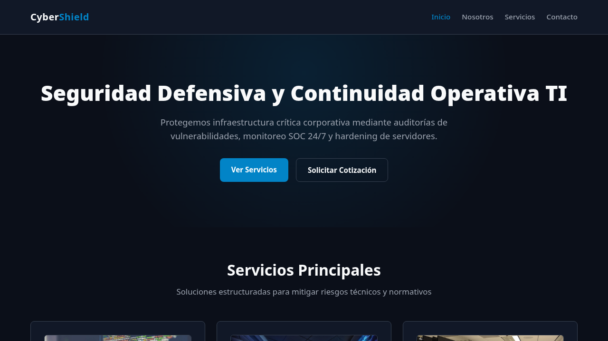
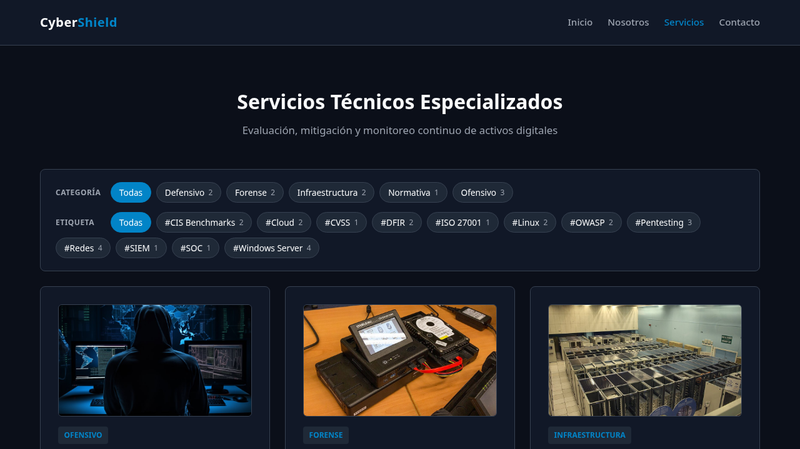

# CyberShield

Sitio web de ejemplo para una empresa de servicios de ciberseguridad, hecho con Django. Tiene un catálogo de servicios que se filtra por categoría y etiqueta, una página de detalle para cada servicio y un formulario de contacto con validaciones. Lo desarrollé como proyecto académico.





## Qué incluye

- Un catálogo con filtros por categoría y etiqueta (`?categoria=` y `?etiqueta=`), paginación de 5 servicios y filtros que se mantienen al cambiar de página. Si el filtro apunta a algo que no existe, responde 404.
- Una página de detalle por servicio.
- Tres modelos: categoría, etiqueta y servicio. Una categoría tiene muchos servicios, y un servicio puede tener varias etiquetas.
- Un procesador de contexto que entrega a todas las plantillas las categorías y etiquetas que tienen servicios disponibles, con su cantidad.
- Consultas con `select_related` y `prefetch_related`, para no repetir consultas a la base de datos.
- Un formulario de contacto que valida el nombre y apellido, el correo corporativo (rechaza Gmail, Hotmail, Outlook, Yahoo y Live) y el celular chileno. Si el servicio es "Otro requerimiento", el mensaje debe tener al menos 50 caracteres. Al enviarlo muestra una confirmación y nada más: no guarda ni envía el mensaje.
- Panel de administración de Django para editar categorías, etiquetas y servicios.
- Página 404 personalizada.
- Configuración para abrir el proyecto en GitHub Codespaces.

## Tecnologías

Python, Django 6, SQLite, HTML, CSS y JavaScript.

## Cómo ejecutarlo

```bash
git clone https://github.com/Mont105/cybershield-django.git
cd cybershield-django
python -m venv .venv
source .venv/bin/activate
pip install -r requirements.txt
export DJANGO_DEBUG=True    # solo para desarrollo local
python manage.py migrate    # crea la base de datos y carga el catálogo
python manage.py runserver
```

Abre http://127.0.0.1:8000. Para entrar al panel, crea un usuario con `python manage.py createsuperuser` y visita `/admin/`.

La clave secreta de Django sale de la variable `DJANGO_SECRET_KEY`. Con `DJANGO_DEBUG=True` el proyecto usa una clave de desarrollo, y sin debug exige que definas la variable. Con debug apagado se ve la página 404 personalizada, que con debug encendido Django reemplaza por su propia pantalla de errores:

```bash
export DJANGO_SECRET_KEY="una-clave-larga-y-aleatoria"
export DJANGO_DEBUG=False
python manage.py runserver --insecure
```

## Pruebas

```bash
python manage.py test
```

Son 22 pruebas. Cubren los filtros y las páginas del catálogo, el 404 de filtros inexistentes y de servicios no disponibles, las validaciones del formulario de contacto, y las páginas de inicio, nosotros y 404.

## Estructura

- `core`: página de inicio, plantilla base y página 404.
- `about`: página "Nosotros".
- `catalog`: modelos, filtros, listado y detalle de servicios.
- `contact`: formulario de contacto y sus validaciones.
- `cybershield`: configuración del proyecto.

## Créditos de imágenes

Las fotos vienen de Wikimedia Commons con licencias libres. Los autores y las licencias están en [`media/catalog/CREDITOS.md`](media/catalog/CREDITOS.md).

## Licencia

MIT. Mira el archivo [LICENSE](LICENSE).
